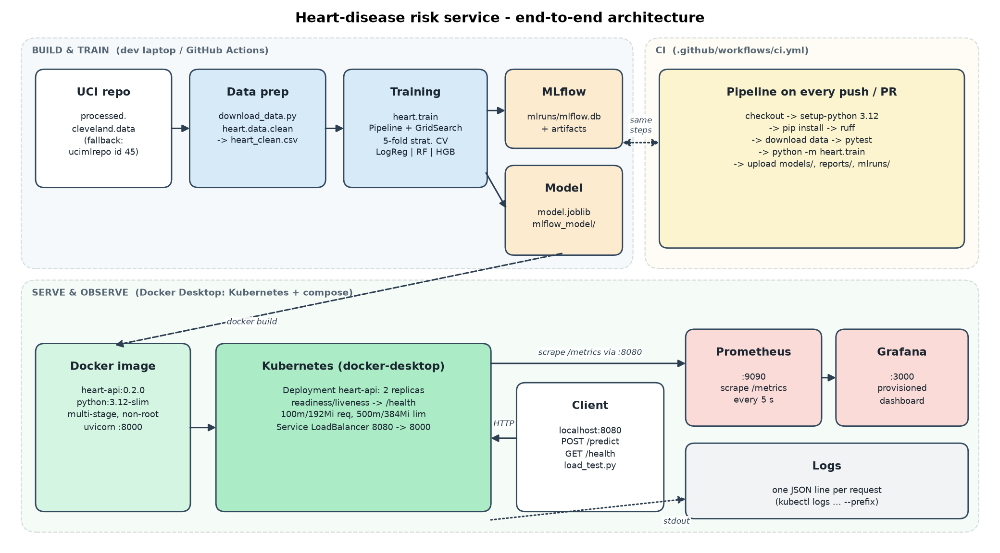

# Heart Disease Risk Classifier - End-to-End MLOps

BITS Pilani WILP - AIMLCZG523 MLOps - Assignment 01 - Jayanth Saish Pamarti

Predicts heart disease (`num > 0`) for the UCI Cleveland dataset and serves the model as a monitored API.
Covers data download, EDA, model training and tuning, MLflow tracking, tests and GitHub Actions CI,
Docker, a Kubernetes deployment, and Prometheus/Grafana monitoring.

- **Repository:** https://github.com/2025ae05879/mlops-heart-disease
- **Report:** `reports/report.pdf` (also `reports/report.docx`)



## Project structure

| Path | Contents |
|---|---|
| `scripts/` | `download_data.py`, `load_test.py`, `build_report.py` |
| `src/heart/` | config, data cleaning, features, models, evaluation, training, MLflow tracking, prediction, FastAPI app, logging and metrics |
| `notebooks/01_eda.ipynb` | EDA notebook |
| `data/raw`, `data/processed` | raw UCI file and cleaned CSV |
| `models/` | `model.joblib`, `mlflow_model/`, `model_meta.json` |
| `reports/` | model comparison, figures, final report |
| `tests/` | pytest tests for data, features, model and API |
| `.github/workflows/ci.yml` | lint, test, train and upload artifacts |
| `Dockerfile`, `requirements-serve.txt` | serving image |
| `k8s/` | `deployment.yaml`, `service.yaml` |
| `monitoring/` | Prometheus + Grafana (docker compose) and dashboard |
| `samples/` | example `/predict` requests |
| `screenshots/` | deployment and monitoring screenshots, saved command outputs |

## Setup (Windows)

```powershell
py -3.12 -m venv .venv
.\.venv\Scripts\python.exe -m pip install -r requirements.txt
.\.venv\Scripts\python.exe -m pip install -e .
```

Docker Desktop with Kubernetes enabled is needed for the deployment steps.

## 1. Data and EDA

```powershell
.\.venv\Scripts\python.exe scripts\download_data.py
.\.venv\Scripts\jupyter.exe nbconvert --to notebook --execute --inplace notebooks\01_eda.ipynb
```

Missing values (`?`) appear only in `ca` (4 rows) and `thal` (2 rows). They are imputed inside the
pipeline (median / most frequent), fitted on training data only. The target is `num > 0` (46% positive).

## 2-3. Training and experiment tracking

```powershell
.\.venv\Scripts\python.exe -m heart.train
.\.venv\Scripts\mlflow.exe ui --backend-store-uri sqlite:///mlruns/mlflow.db
```

- Models: Logistic Regression, Random Forest, HistGradientBoosting, tuned with GridSearchCV and
  stratified 5-fold CV on an 80/20 split.
- Selection: highest CV recall among models within 0.02 of the best CV ROC-AUC. Chosen model is
  Logistic Regression (CV AUC 0.910, test AUC 0.913). See `reports/model_comparison.md`.
- MLflow logs parameters, metrics, ROC and confusion plots, and the model for every run.

## 4. Packaging

The full preprocessing + model pipeline is saved as `models/model.joblib` and `models/mlflow_model/`.
Dependencies are pinned in `requirements.txt`.

## 5. Tests and CI

```powershell
.\.venv\Scripts\ruff.exe check .
.\.venv\Scripts\python.exe -m pytest -v
```

GitHub Actions (`.github/workflows/ci.yml`) runs lint, tests and training on every push and pull
request, and uploads the model and reports as artifacts.

## 6. Docker

```powershell
docker build -t heart-api:0.2.0 .
docker run -d --name heart-api-local -p 8000:8000 heart-api:0.2.0
curl.exe -X POST http://localhost:8000/predict -H "Content-Type: application/json" --data-binary "@samples/sample_request.json"
```

`/predict` returns the prediction, label, probability and confidence. Invalid input returns HTTP 422.

## 7. Kubernetes (Docker Desktop)

```powershell
kubectl config use-context docker-desktop
kubectl apply -f k8s/
kubectl get pods,svc,deploy
curl.exe http://localhost:8080/health
```

Runs 2 replicas behind a LoadBalancer service on port 8080 (port 80 was already in use on the
development machine; change `port` in `k8s/service.yaml` if needed).

## 8. Monitoring

```powershell
docker compose -f monitoring/docker-compose.yml up -d
.\.venv\Scripts\python.exe scripts\load_test.py --n 60
```

- Prometheus: http://localhost:9090
- Grafana: http://localhost:3000 (login `admin` / `heart-mlops`, local only), dashboard "Heart API"
- Logs: one JSON line per request, `kubectl logs -l app.kubernetes.io/name=heart-api`
- Metrics at `/metrics`: request count, latency, predictions by class, model-loaded flag

Note: Prometheus scrapes through the LoadBalancer, so per-replica numbers are approximate.

To stop everything:

```powershell
docker compose -f monitoring/docker-compose.yml down
kubectl delete -f k8s/
```